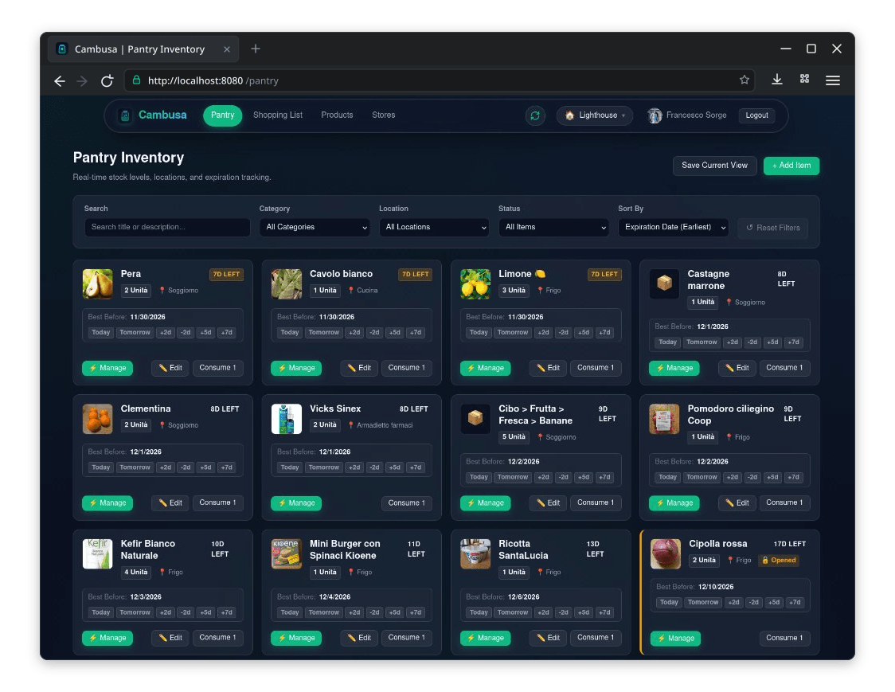

# Cambusa

<p align="center">
  
</p>

<p align="center">
  <strong>The private-first, self-hostable home pantry, grocery manager, and meal companion.</strong><br>
  <em>Designed for families, food enthusiasts, and smart homes — fully offline-first with zero telemetry.</em>
</p>

<p align="center">
  <a href="LICENSE"></a>
  <a href="https://angular.dev"></a>
  <a href="https://nestjs.com"></a>
  <a href="docs/OFFLINE_SYNC.md"></a>
  <a href="https://www.docker.com"></a>
</p>

<p align="center">
  
</p>

## Why Cambusa?

Food waste is costly and frustrating, grocery planning across family members can be chaotic, and most home inventory tools are either clunky spreadsheets or cloud services that monetize your personal data.

**Cambusa** (Italian for the galley or ship's pantry) is built to make food management effortless, reliable, and visually delightful:

- 🥑 **Never Let Food Go to Waste**: Clear, color-coded expiration timelines ensure you consume what is due first.
- 🛒 **Shop in Record Time**: Multi-store shopping lists automatically sorted by the real walking aisle order of your local supermarket.
- 📶 **Works Everywhere (Even With Zero Signal)**: Take your shopping list into supermarket basements without losing connectivity. Cambusa is an offline-first Progressive Web App (PWA) that syncs seamlessly when you're back online.
- 🏡 **Built for Households**: Switch between multiple households (home, vacation cabin, shared space) with individual member access and privacy-first single sign-on.
- 🍲 **Connected to Your Kitchen**: Seamlessly integrates with **Mealie** for recipe discovery based on on-hand ingredients, and **Home Assistant** for smart kitchen dashboards and e-ink displays.
- ⚡ **Accident-Proof**: Made a mistake while logging purchases or consumption? Every action features a 10-second instant undo.

## Highlights & Features

### 📦 Smart Pantry & Expiration Tracking
- **Expiration-First Priority**: Inventory is automatically ordered by best-before and use-by dates, with vivid urgency badges highlighting what needs attention.
- **Single-Tap Quick Date Adjustments**: Postpone or adjust due dates on the fly with fast date chips (`Today`, `Tomorrow`, `+2d`, `+7d`).
- **Batch & Location Control**: Group inventory into unified product cards while tracking distinct batches across pantries, refrigerators, and freezers.
- **Freezer Protection**: Guard items with freezer-safety constraints and automatic shelf-life recalculation upon freezing and thawing.
- **Accurate Actions**: Easily record items as **Consumed** (with spoiled waste tracking), **Purchased** (with price and store details), or **Moved** between rooms.
- **Instant Search & Filters**: Search catalog names and descriptions in real time, filter by category or storage location, and save your favorite view presets.

### 🛒 Intelligent Supermarket Shopping Lists
- **Store-Aware Walking Order**: Organize your shopping items by actual aisle sequences (`Produce` &rarr; `Bakery` &rarr; `Dairy`), eliminating zig-zagging through the store.
- **Multi-List Flexibility**: Maintain distinct lists for different stores (e.g. Weekly Supermarket, Farmer's Market, Wholesale Club, Pharmacy).
- **One-Click Low-Stock Restocking**: Instantly restock items that have dropped below your configured pantry thresholds.
- **Non-Destructive Cart Check-Off**: Checking off an item marks it completed without deleting it from your list or altering inventory until you choose to restock.
- **Uncataloged Quick Items**: Add ad-hoc shopping items on the fly without having to set up formal catalog entries beforehand.

### 🍲 Kitchen & Smart Home Integrations
- **Mealie Recipe Companion**: Connect your [Mealie](https://mealie.io) recipe manager to discover recipes you can cook right now with what is currently in stock. Open recipes with mapped ingredients directly in a single click.
- **Next Engine Feed (`/api/next`)**: A dedicated high-performance JSON endpoint built for external integrations, Home Assistant sensor dashboards, and kitchen e-ink displays.
- **Daily Morning Email Digest**: Wake up to an elegant graphical summary of food expiring soon, complete with item photos, days remaining, and direct dashboard links.
- **Developer API Keys**: Generate secure, revocable 256-bit API keys directly from your profile to build your own scripts and automations.

### ⚡ Accident-Proof 10-Second Undo
- Tapped "Consume" or "Purchased" by mistake? Cambusa gives you a persistent 10-second countdown toast on every inventory mutation.
- A single click reverses the entire operation cleanly without manual database corrections.

### 📶 Offline-First PWA Resilience
- Built from the ground up as an offline-first Progressive Web Application.
- Works offline via client-side IndexedDB storage and Cache-First Service Workers.
- Transparent bi-directional synchronization with Last-Write-Wins (LWW) conflict resolution and tombstone deletion tracking once your device reconnects.

### 🎨 Modern Aero Glass Interface
- Built with a frosted glass aesthetic, featuring smooth backdrop blurs and floating navigation islands.
- Automatic OS-native Dark and Light mode adaptation (`prefers-color-scheme`).
- Fully responsive across desktop, tablet, and mobile screens with a dedicated mobile drawer and touch-friendly controls.

### 🔄 Easy Grocy Migration
- Moving from Grocy? Cambusa includes a dedicated CLI migration tool that imports your products, barcodes, storage locations, product pictures, stock items, and shopping lists in seconds.

## Quick Start

### 1. Production Deployment (Docker Compose)

The easiest way to run Cambusa is using Docker Compose:

```bash
# Clone the repository
git clone https://github.com/your-username/cambusa.git
cd cambusa

# Copy the example environment configuration
cp .env.example .env

# Edit .env with your session secrets and OIDC provider details
# nano .env

# Launch the unified container
docker compose up -d
```

Cambusa will be accessible at `http://localhost:8080`.

### 2. Local Development

#### Prerequisites
- **Node.js**: v22+ (v26 recommended)
- **npm**: v11+

#### Setup & Execution

```bash
# 1. Install dependencies
cd backend && npm install
cd ../frontend && npm install
cd ..

# 2. Configure environment
cp .env.example .env

# 3. Start development servers
npm run start:backend   # NestJS API running on http://localhost:3000
npm run start:frontend  # Angular SPA running on http://localhost:4200
```

Open `http://localhost:4200` in your browser. The Angular dev server automatically proxies `/api/*` calls to the NestJS backend.

## Grocy Data Migration

If you are migrating from an existing Grocy installation, run the automated migration command:

```bash
# Specify the path to your Grocy backup directory containing grocy.db and product pictures:
npm run migrate:grocy -- /path/to/grocy-backup

# Optional: target a specific household UUID
npm run migrate:grocy -- /path/to/grocy-backup --household-id <TARGET_HOUSEHOLD_UUID>
```

The migration tool automatically:
- Converts and optimizes all product pictures to WebP format (`1200x1200` max inside fit, 85% quality).
- Imports quantity units, categories, storage locations, stores, and parent-child product trees.
- Normalizes Grocy sentinel dates (e.g. `2999-12-31`) to standard `null` dates.
- Migrates existing stock batches and active shopping lists.

## Technical Documentation Suite

For comprehensive deep dives into Cambusa's architecture, data model, security implementation, and APIs, refer to the technical guides in [`docs/`](docs/):

| Document | Focus & Highlights |
| :--- | :--- |
| **[System Architecture](docs/ARCHITECTURE.md)** | High-level topology, BFF pattern, Aero Glass design system, Mealie and email architecture, component structure. |
| **[Data Model & Database](docs/DATA_MODEL.md)** | TypeORM schema, SQLite WAL pragmas, infinite parent-child product hierarchy, cascading relations. |
| **[Authentication & Security](docs/AUTHENTICATION.md)** | OpenID Connect (OIDC) PKCE flow, HttpOnly cookie security, household tenant isolation guards. |
| **[Offline Synchronization](docs/OFFLINE_SYNC.md)** | IndexedDB client storage, Service Worker caching, Last-Write-Wins (LWW) conflict resolution, tombstones. |
| **[API Reference](docs/API_REFERENCE.md)** | Complete REST endpoint specifications, request/response schemas, `/api/next` engine parameters. |
| **[Deployment & DevOps](docs/DEPLOYMENT_AND_DEVOPS.md)** | Unified Docker container, Nginx reverse proxy, Supervisor process manager, multi-arch CI/CD. |

## Technology Stack

- **Frontend**: [Angular 22](https://angular.dev) (100% Standalone Components, Angular Signals, Angular CDK Dialog & Drag-Drop), IndexedDB, Service Worker.
- **Backend**: [NestJS 12](https://nestjs.com), [TypeORM 1.1](https://typeorm.io), `better-sqlite3` (WAL mode enabled), `sharp` (WebP image processing), `nodemailer`, `jose`.
- **Infrastructure**: Single-container multi-stage build running Nginx reverse proxy and NestJS supervised by `supervisord`.

## License

This project is licensed under the **AGPL-3.0-or-later** License. See the [LICENSE](LICENSE) file for details.
