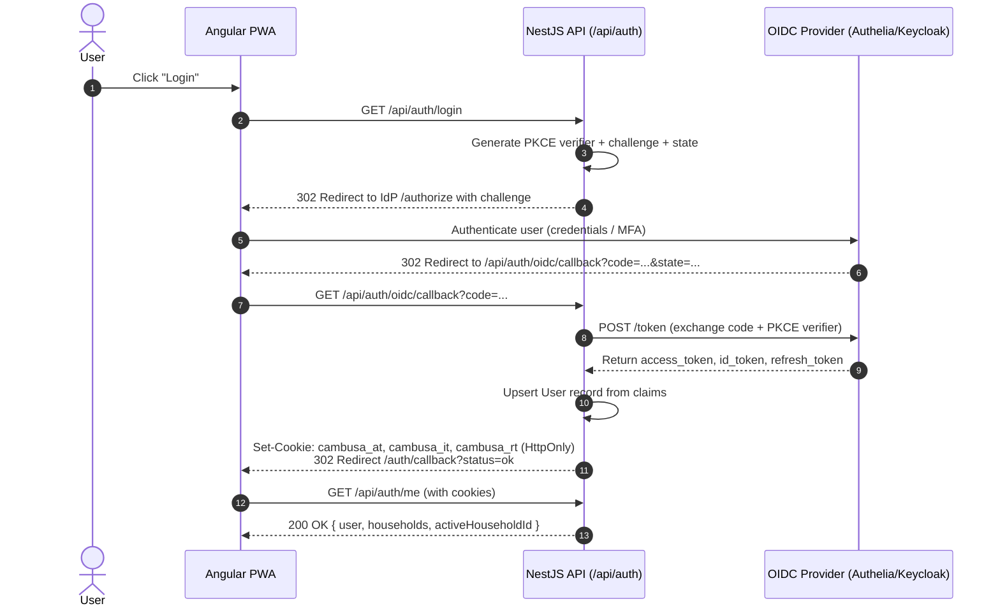

# Authentication & Security Specification — Cambusa

Cambusa implements a hardened **Backend-for-Frontend (BFF)** security architecture utilizing OpenID Connect (OIDC) with the Authorization Code Flow and Proof Key for Code Exchange (PKCE).

---

## 1. Security Architecture Principles

1. **Zero JavaScript Access to Tokens**:
   - Access tokens (`cambusa_at`), ID tokens (`cambusa_it`), and Refresh tokens (`cambusa_rt`) are stored exclusively in `HttpOnly`, `SameSite=Lax`, and `Secure` cookies.
   - The Angular client never reads, stores, or handles JWT tokens directly, completely mitigating token theft through XSS.

2. **Tenant Isolation via Guard Pipeline**:
   - Every protected API endpoint is protected by:
     - `BearerJwtGuard`: Authenticates the user and attaches claims to `request.user`.
     - `HouseholdMemberGuard`: Verifies that the authenticated user is an active member of the household specified in `X-Household-Id`.

3. **Explicit Authentication Enforcement**:
   - Protected API endpoints never bypass authentication. Requests missing valid session tokens or cookies immediately receive `401 Unauthorized`.
   - In development environments without an external OIDC provider, explicit dev login (`/api/auth/login`) issues session cookies (`cambusa_at=dev-access-token`) to maintain authentic guard flows without auto-bypassing unauthenticated visitors.

4. **Client-Side Route Protection (`authGuard`)**:
   - All internal Angular routes (`/pantry`, `/shopping`, `/products`, `/stores`, `/households`) are gated by `authGuard`.
   - Unauthenticated visitors are automatically routed to `/login`. Once authenticated, `guestGuard` prevents access to `/login` and redirects users directly to `/pantry`.

---

## 2. Authentication Flow



---

## 3. Cookie Storage & Configuration

Cookies set by Cambusa on successful authentication:

| Cookie Name | Scope | HttpOnly | SameSite | Secure | Description |
| :--- | :--- | :--- | :--- | :--- | :--- |
| `cambusa_at` | `/` | Yes | Lax | Yes (Prod) | OIDC Access Token |
| `cambusa_it` | `/` | Yes | Lax | Yes (Prod) | OIDC ID Token (contains user claims) |
| `cambusa_rt` | `/api/auth` | Yes | Lax | Yes (Prod) | OIDC Refresh Token |
| `cambusa_pkce` | `/api/auth` | Yes | Lax | Yes (Prod) | Ephemeral PKCE verifier (cleared after callback) |

---

## 4. Endpoints & Controller Logic

### 4.1 `/api/auth/login`
- Generates a random `state` and PKCE `code_verifier`.
- Computes SHA-256 `code_challenge` from the verifier.
- Stores the verifier in the encrypted `cambusa_pkce` cookie.
- Redirects to `${OIDC_ISSUER_URL}/protocol/openid-connect/auth` with query parameters: `client_id`, `response_type=code`, `scope=openid profile email`, `code_challenge`, and `code_challenge_method=S256`.

### 4.2 `/api/auth/oidc/callback`
- Validates the incoming `state` and retrieves `code_verifier` from `cambusa_pkce`.
- Issues a back-channel POST request to the provider's token endpoint to exchange the authorization code.
- Decodes the verified ID token via `jose` JWKS verification to extract `sub`, `email`, `name`, and `picture` claims (supporting standard `picture` as well as `avatar_url` and `picture_url`).
- Upserts the `User` entity in SQLite with `displayName`, `email`, and `pictureUrl`, and provisions a default household if the user is new.
- Issues the session cookies and redirects the browser to `/auth/callback?status=ok`.

### 4.3 `/api/auth/me`
Protected endpoint returning active user context and household memberships:
```json
{
  "user": {
    "id": "e9324d27-4648-4394-bb9e-315147be15e3",
    "email": "user@example.com",
    "displayName": "John Doe",
    "pictureUrl": "https://avatar.example.com/photo.webp"
  },
  "households": [
    {
      "id": "787c800c-bce0-4284-82f5-b3e10884df00",
      "name": "Main Home",
      "role": "owner",
      "isOwner": true,
      "memberCount": 2
    }
  ],
  "activeHouseholdId": "787c800c-bce0-4284-82f5-b3e10884df00",
  "pendingInvitationsCount": 0
}
```

### 4.4 `/api/auth/refresh`
- Reads the HttpOnly `cambusa_rt` refresh token cookie.
- Issues a back-channel request to the provider's token endpoint with `grant_type=refresh_token`.
- Refreshes `cambusa_at`, `cambusa_it`, and rotates/extends `cambusa_rt`.
- Returns `{ refreshed: true, expiresIn: number }` allowing seamless transparent token renewal.

### 4.5 `/api/auth/logout`
- Clears all session cookies (`cambusa_at`, `cambusa_it`, `cambusa_rt`).
- Returns `{ loggedOut: true }` and routes to login.

---

## 5. Background Token Refresh & Session Resilience

Cambusa features continuous proactive background token lifecycle management modeled after enterprise BFF resilience standards:

### 5.1 Proactive Token Refresh
- **Focus & Visibility Watchers**: On browser tab visibility change (`document.visibilitychange`) or window focus (`window.focus`), the client checks elapsed time against `proactiveRefreshIntervalMs` (default: 4 minutes, dynamically calibrated from `expiresIn - 60s`). If elapsed, `silentRefresh()` is invoked proactively in the background before tokens can expire.
- **Session Ping Heartbeat**: While authenticated, an interval heartbeat checks session status every 30 seconds outside Angular's zone (`runOutsideAngular`) via `/api/auth/me`. If proactive refresh is due, it renews tokens quietly.

### 5.2 Transparent HTTP Interceptor (`authInterceptor`)
- All outgoing `/api/*` HTTP requests automatically attach `withCredentials: true`.
- If any API request encounters HTTP 401/403 (excluding login/logout/refresh endpoints):
  1. The interceptor intercepts the failure and initiates `AuthService.silentRefresh()`.
  2. If the token refresh succeeds, the original request is transparently re-executed without user interruption.
  3. If the refresh token is missing or rejected by the IdP, `handleSessionExpired()` is invoked.

### 5.3 Session Expired CDK Modal Alert
- When a session has definitively expired and cannot be refreshed silently:
  1. User authentication state and cached household context are cleared.
  2. A non-closable Angular CDK Dialog (`ConfirmModalComponent`) modal opens with:
     - **Title**: *Session Expired*
     - **Message**: *Your authentication session has expired. Please refresh the page to renew your session and continue using Cambusa.*
     - **Action**: *Refresh Page* button with primary emphasis (`confirmVariant: 'primary'`).
  3. Clicking *Refresh Page* immediately reloads the application and preserves the user's current route in `sessionStorage` (`cambusa_auth_return_url`) so the user returns to their active workspace upon re-authentication.

---

## 6. Security Guards & Decorators

### Backend: `BearerJwtGuard`
Validates authentication on every request:
1. Inspects the incoming `cambusa_at` cookie or `Authorization: Bearer <token>` header. If missing, immediately throws `UnauthorizedException` (401).
2. With OIDC configured: validates the JWT signature against the OIDC issuer's JWKS endpoint using `jose.createRemoteJWKSet`.
3. Enriches claims from the ID token (`cambusa_it`) when user profile claims or avatar (`picture`, `avatar_url`, `picture_url`) are omitted in the access token.
4. Attaches verified user claims to `request.user` and upserts the user in the SQLite database, syncing display name, email, and profile avatar URL.
5. In local development mode without OIDC: validates explicit dev session cookies (`cambusa_at=dev-access-token`) issued on login.

### Backend: `HouseholdMemberGuard`
Ensures strict multi-tenant boundary enforcement:
1. Reads `X-Household-Id` header (or route param `:householdId`).
2. Queries `household_members` table for `{ userId: user.id, householdId }`.
3. Throws `ForbiddenException` (HTTP 403) if the user is not a verified member.

### Backend: Household Ownership Verification
Administrative and destructive actions on households (such as renaming or deleting a household via `PUT /api/households/:id` or `DELETE /api/households/:id`) explicitly verify that `household.ownerId === user.id`. If a non-owner member attempts to rename or delete the household, the controller throws `ForbiddenException` (HTTP 403 Forbidden: "Only the household owner can rename/delete this household").

### Frontend: `authGuard` & `guestGuard`
1. `authGuard`: Evaluated before activating any protected route (`/pantry`, `/shopping`, `/products`, `/stores`, `/households`). If the user is unauthenticated, redirects to `/login` with `returnUrl`.
2. `guestGuard`: Prevents authenticated users from seeing the `/login` view, redirecting them directly to `/pantry`.

### Custom Decorators
- `@CurrentUser()`: Extracts the authenticated `AuthUser` object from `request.user`.
- `@ActiveHouseholdId()`: Extracts the validated active `householdId` from `request.householdId`.
