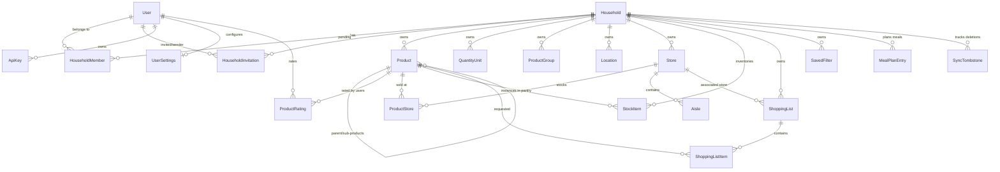

# Data Model Specification — Cambusa

Cambusa uses an embedded SQLite database managed by TypeORM and driven by the high-performance `better-sqlite3` driver configured in Write-Ahead Logging (WAL) mode.

---

## 1. Database Configuration & Pragmas

When Cambusa initializes its database connection (`backend/src/database/database.config.ts`), the following SQLite PRAGMAs are executed:

```sql
PRAGMA journal_mode = WAL;
PRAGMA synchronous = NORMAL;
PRAGMA foreign_keys = ON;
PRAGMA busy_timeout = 5000;
PRAGMA cache_size = -20000; -- 20MB cache
```

- **WAL Mode**: Allows concurrent readers and one writer without contention.
- **Synchronous NORMAL**: Provides durability without unnecessary disk fsync bottlenecks.
- **Foreign Keys**: Enforces relational integrity across entities.

---

## 2. Entity-Relationship Diagram



---

## 3. Entity Definitions

### 3.1 Identity & Tenancy Entities

#### `User` (`users`)
Represents an authenticated individual identified by OIDC subject claims.
| Column | Type | Constraints | Description |
| :--- | :--- | :--- | :--- |
| `id` | UUID | PRIMARY KEY | Unique user ID |
| `subject` | VARCHAR | UNIQUE, NOT NULL | Subject claim from OIDC provider (`sub`) |
| `email` | VARCHAR | UNIQUE, NULLABLE | User email address |
| `displayName` | VARCHAR | NOT NULL | Display name |
| `pictureUrl` | VARCHAR | NULLABLE | Profile avatar image URL from OIDC identity provider |
| `createdAt` | DATETIME | NOT NULL | Record creation timestamp |
| `updatedAt` | DATETIME | NOT NULL | Last update timestamp |

#### `Household` (`households`)
Represents an isolated home tenant containing independent catalogs, inventory, and lists.
| Column | Type | Constraints | Description |
| :--- | :--- | :--- | :--- |
| `id` | UUID | PRIMARY KEY | Unique household ID |
| `name` | VARCHAR | NOT NULL | Household name (e.g. "Main Home") |
| `ownerId` | VARCHAR | NOT NULL | User ID of the household creator/owner (only owners can rename or delete) |
| `createdAt` | DATETIME | NOT NULL | Creation timestamp |
| `updatedAt` | DATETIME | NOT NULL | Last update timestamp |

#### `HouseholdMember` (`household_members`)
Associates users with households and assigns permissions.
| Column | Type | Constraints | Description |
| :--- | :--- | :--- | :--- |
| `id` | UUID | PRIMARY KEY | Membership record ID |
| `householdId` | VARCHAR | INDEX, NOT NULL, FK &rarr; `households(id)` ON DELETE CASCADE | Target household |
| `userId` | VARCHAR | INDEX, NOT NULL | Associated user |
| `role` | VARCHAR | NOT NULL | Role: `owner` or `member` |
| `joinedAt` | DATETIME | NOT NULL | Membership creation timestamp |

#### `HouseholdInvitation` (`household_invitations`)
Handles pending invitations sent by household owners to prospective members.
| Column | Type | Constraints | Description |
| :--- | :--- | :--- | :--- |
| `id` | UUID | PRIMARY KEY | Invitation record ID |
| `householdId` | VARCHAR | INDEX, NOT NULL, FK &rarr; `households(id)` ON DELETE CASCADE | Household extending the invitation |
| `email` | VARCHAR | INDEX, NOT NULL | Invited user email |
| `invitedByUserId` | VARCHAR | NOT NULL | User who initiated the invite |
| `role` | VARCHAR | NOT NULL | Target role (`member`) |
| `status` | VARCHAR | NOT NULL | Status: `pending`, `accepted`, `declined` |
| `createdAt` | DATETIME | NOT NULL | Creation timestamp |

#### `ApiKey` (`api_keys`)
Stores cryptographically hashed API access tokens for external automated services and widgets.
| Column | Type | Constraints | Description |
| :--- | :--- | :--- | :--- |
| `id` | UUID | PRIMARY KEY | API Key ID |
| `userId` | VARCHAR | INDEX, NOT NULL, FK &rarr; `users(id)` ON DELETE CASCADE | Owner user |
| `name` | VARCHAR | NOT NULL | Friendly application/device label |
| `keyHash` | VARCHAR | INDEX, UNIQUE, NOT NULL | SHA-256 hash of the generated raw key |
| `keyPrefix` | VARCHAR | NOT NULL | Truncated prefix (e.g. `cambusa_ak_49f8...`) for UI display |
| `lastUsedAt` | DATETIME | NULLABLE | Timestamp of the most recent API request authenticated with this key |
| `createdAt` | DATETIME | NOT NULL | Key generation timestamp |

#### `UserSettings` (`user_settings`)
Stores per-user customization preferences, Next scan horizons, and external integration credentials.
| Column | Type | Constraints | Description |
| :--- | :--- | :--- | :--- |
| `id` | UUID | PRIMARY KEY | Settings record ID |
| `userId` | VARCHAR | INDEX, UNIQUE, NOT NULL, FK &rarr; `users(id)` ON DELETE CASCADE | Owner user |
| `nextExpiringDays` | INTEGER | NOT NULL, DEFAULT 5 | Number of days ahead scanned by the `/api/next` engine |
| `mealieUrl` | VARCHAR | NULLABLE | Self-hosted Mealie recipe manager base URL |
| `mealieApiToken` | VARCHAR | NULLABLE | Bearer API token for Mealie recipe book sync |
| `mealieLinked` | BOOLEAN | NOT NULL, DEFAULT FALSE | Whether Mealie is configured and active |
| `notificationEmail` | VARCHAR | NULLABLE | Recipient email address for daily digest notifications (defaults to account email if null) |
| `emailNotificationsEnabled` | BOOLEAN | NOT NULL, DEFAULT FALSE | Whether daily morning digest email is enabled |
| `notificationTime` | VARCHAR | NOT NULL, DEFAULT '06:00' | Scheduled daily digest time in 24h format (`HH:MM`) |
| `lastNotificationSentDate` | VARCHAR | NULLABLE | Last date (`YYYY-MM-DD`) notification was sent, preventing duplicate same-day dispatches |
| `updatedAt` | DATETIME | NOT NULL | Last modification timestamp |

---

### 3.2 Product & Catalog Entities

#### `ProductGroup` (`product_groups`)
Categories for organizing products (e.g. "Dairy", "Produce", "Bakery").
| Column | Type | Constraints | Description |
| :--- | :--- | :--- | :--- |
| `id` | UUID | PRIMARY KEY | Product group ID |
| `householdId` | VARCHAR | INDEX, NOT NULL, FK &rarr; `households(id)` ON DELETE CASCADE | Household scope |
| `name` | VARCHAR | NOT NULL | Category name |
| `description` | TEXT | NULLABLE | Category description |
| `active` | BOOLEAN | DEFAULT TRUE | Active status |
| `createdAt` | DATETIME | NOT NULL | Creation timestamp |
| `updatedAt` | DATETIME | NOT NULL | Last update timestamp |

#### `QuantityUnit` (`quantity_units`)
Units of measure for inventory and shopping quantities (e.g. "Piece", "kg", "Pack").
| Column | Type | Constraints | Description |
| :--- | :--- | :--- | :--- |
| `id` | UUID | PRIMARY KEY | Quantity unit ID |
| `householdId` | VARCHAR | INDEX, NOT NULL, FK &rarr; `households(id)` ON DELETE CASCADE | Household scope |
| `name` | VARCHAR | NOT NULL | Singular unit name |
| `namePlural` | VARCHAR | NULLABLE | Plural unit name |
| `description` | TEXT | NULLABLE | Unit description |
| `active` | BOOLEAN | DEFAULT TRUE | Active status |
| `createdAt` | DATETIME | NOT NULL | Creation timestamp |
| `updatedAt` | DATETIME | NOT NULL | Last update timestamp |

#### `Location` (`locations`)
Physical storage spaces (e.g. "Fridge", "Pantry", "Freezer").
| Column | Type | Constraints | Description |
| :--- | :--- | :--- | :--- |
| `id` | UUID | PRIMARY KEY | Location ID |
| `householdId` | VARCHAR | INDEX, NOT NULL, FK &rarr; `households(id)` ON DELETE CASCADE | Household scope |
| `name` | VARCHAR | NOT NULL | Location name |
| `description` | TEXT | NULLABLE | Storage notes |
| `isFreezer` | BOOLEAN | DEFAULT FALSE | If true, applies freezing/thawing rules and rejects non-freezable products |
| `active` | BOOLEAN | DEFAULT TRUE | Active status |
| `createdAt` | DATETIME | NOT NULL | Creation timestamp |
| `updatedAt` | DATETIME | NOT NULL | Last update timestamp |

#### `Product` (`products`)
Primary catalog entity supporting infinite recursive parent hierarchies, multi-photos, multi-barcodes, and expiration policies.
| Column | Type | Constraints | Description |
| :--- | :--- | :--- | :--- |
| `id` | UUID | PRIMARY KEY | Unique product ID |
| `householdId` | VARCHAR | INDEX, NOT NULL, FK &rarr; `households(id)` ON DELETE CASCADE | Household scope |
| `name` | VARCHAR | NOT NULL | Product name |
| `description` | TEXT | NULLABLE | Detailed description (HTML or text) |
| `barcodes` | TEXT (JSON) | DEFAULT '[]' | JSON array of EAN/UPC barcodes |
| `pictureFileNames` | TEXT (JSON) | DEFAULT '[]' | Ordered JSON array of WebP filenames in `uploads/products/` |
| `mealieFoods` | TEXT (JSON) | DEFAULT '[]' | JSON array of mapped Mealie food entities (`[{ id, name }]`) |
| `mealieRecipes` | TEXT (JSON) | DEFAULT '[]' | JSON array of explicitly mapped Mealie recipes (`[{ id, slug, name }]`) |
| `cannotBeFrozen` | BOOLEAN | DEFAULT FALSE | If true, prevents assignment or transfers to freezer locations, omits freezer options from storage selectors, and forces freezing/thawing shelf-life fields to NULL |
| `openLocationId` | VARCHAR | NULLABLE, FK &rarr; `locations(id)` ON DELETE SET NULL | Destination location when item is unsealed |
| `moveOnOpen` | BOOLEAN | DEFAULT FALSE | Automatically move item to `openLocationId` upon opening |
| `defaultStoreId` | VARCHAR | NULLABLE, FK &rarr; `stores(id)` ON DELETE SET NULL | Preferred retail store |
| `dueType` | VARCHAR | DEFAULT 'best_before' | Expiration mode (`best_before` or `use_by`) |
| `defaultBestBeforeDays` | INTEGER | DEFAULT 0 | Shelf life in days from purchase date |
| `defaultBestBeforeDaysAfterOpen` | INTEGER | NULLABLE | Shelf life in days after unsealing |
| `defaultBestBeforeDaysAfterFreezing` | INTEGER | NULLABLE | Shelf life in days when placed in freezer (enforced NULL if `cannotBeFrozen` is true) |
| `defaultBestBeforeDaysAfterThawing` | INTEGER | NULLABLE | Shelf life in days after thawing from freezer (enforced NULL if `cannotBeFrozen` is true) |
| `minStockAmount` | REAL | DEFAULT 0 | Minimum desired pantry threshold |
| `treatOpenedAsOutOfStock` | BOOLEAN | DEFAULT FALSE | Exclude opened packages from stock thresholds |
| `productGroupId` | VARCHAR | NULLABLE, FK &rarr; `product_groups(id)` ON DELETE SET NULL | Associated product group / category |
| `defaultLocationId` | VARCHAR | NULLABLE, FK &rarr; `locations(id)` ON DELETE SET NULL | Default storage location |
| `quStockId` | VARCHAR | NULLABLE, FK &rarr; `quantity_units(id)` ON DELETE SET NULL | Quantity unit for pantry stock |
| `quPurchaseId` | VARCHAR | NULLABLE, FK &rarr; `quantity_units(id)` ON DELETE SET NULL | Quantity unit for shopping purchase |
| `quFactor` | REAL | DEFAULT 1.0 | Conversion ratio from purchase unit to stock unit |
| `yukaScore` | INTEGER | NULLABLE | Nutritional score (0–100) |
| `tastesGood` | BOOLEAN | NULLABLE | Preference indicator |
| `parentProductId` | VARCHAR | INDEX, NULLABLE, FK &rarr; `products(id)` ON DELETE SET NULL | Self-referencing link to parent product |
| `active` | BOOLEAN | DEFAULT TRUE | Active status |
| `createdAt` | DATETIME | NOT NULL | Creation timestamp |
| `updatedAt` | DATETIME | NOT NULL | Last update timestamp |

> **Infinite Recursive Hierarchies**: `Product` links to `Product` via `parentProductId`. Parent products aggregate direct inventory and all recursive descendants. Cyclic references are rejected at creation and update time.

#### `Store` (`stores`)
Physical or online grocery retail store.
| Column | Type | Constraints | Description |
| :--- | :--- | :--- | :--- |
| `id` | UUID | PRIMARY KEY | Store ID |
| `householdId` | VARCHAR | INDEX, NOT NULL, FK &rarr; `households(id)` ON DELETE CASCADE | Household scope |
| `name` | VARCHAR | NOT NULL | Store name (e.g. "Coop", "Esselunga", "Lidl") |
| `description` | TEXT | NULLABLE | Optional store notes |
| `createdAt` | DATETIME | NOT NULL | Creation timestamp |
| `updatedAt` | DATETIME | NOT NULL | Last update timestamp |

#### `Aisle` (`aisles`)
Physical aisle or section within a specific store/supermarket, supporting customizable sequential drag-and-drop route ordering.
| Column | Type | Constraints | Description |
| :--- | :--- | :--- | :--- |
| `id` | UUID | PRIMARY KEY | Aisle ID |
| `householdId` | VARCHAR | INDEX, NOT NULL, FK &rarr; `households(id)` ON DELETE CASCADE | Household scope |
| `storeId` | VARCHAR | INDEX, NOT NULL, FK &rarr; `stores(id)` ON DELETE CASCADE | Parent store scope |
| `name` | VARCHAR | NOT NULL | Aisle designation (e.g. "Produce", "Bakery", "Aisle 4") |
| `sortOrder` | INTEGER | NOT NULL, DEFAULT 0 | Sequential position for shopping routing |
| `createdAt` | DATETIME | NOT NULL | Creation timestamp |
| `updatedAt` | DATETIME | NOT NULL | Last update timestamp |

> **Unique & Ordering Constraints**: Enforces `UNIQUE(householdId, storeId, name)` and an index on `(householdId, storeId, sortOrder)`. Deletions trigger mandatory `SyncTombstone` records (`entityType: 'aisle'`) to maintain offline sync consistency.

#### `ProductStore` (`product_stores`)
Product-to-store mapping with store-specific aisle order and price history.
| Column | Type | Constraints | Description |
| :--- | :--- | :--- | :--- |
| `id` | UUID | PRIMARY KEY | Mapping record ID |
| `householdId` | VARCHAR | INDEX, NOT NULL, FK &rarr; `households(id)` ON DELETE CASCADE | Household scope |
| `productId` | VARCHAR | INDEX, NOT NULL, FK &rarr; `products(id)` ON DELETE CASCADE | Associated product |
| `storeId` | VARCHAR | INDEX, NOT NULL, FK &rarr; `stores(id)` ON DELETE CASCADE | Associated store |
| `aisle` | VARCHAR | NULLABLE | Store aisle designation (e.g. "Aisle 4", "Dairy") |
| `aisleOrder` | INTEGER | NULLABLE | Integer sequence order for shopping path sorting |
| `averagePrice` | REAL | NULLABLE | Last or average recorded unit purchase price |
| `isPreferred` | BOOLEAN | DEFAULT FALSE | Preferred supermarket for this product |
| `createdAt` | DATETIME | NOT NULL | Creation timestamp |
| `updatedAt` | DATETIME | NOT NULL | Last update timestamp |

#### `ProductRating` (`product_ratings`)
Per-user star rating for a catalog product within a household (`null` for unrated, or `1` to `5`).
| Column | Type | Constraints | Description |
| :--- | :--- | :--- | :--- |
| `id` | UUID | PRIMARY KEY | Rating record ID |
| `householdId` | VARCHAR | INDEX, NOT NULL, FK &rarr; `households(id)` ON DELETE CASCADE | Household scope |
| `productId` | VARCHAR | INDEX, NOT NULL, FK &rarr; `products(id)` ON DELETE CASCADE | Rated product |
| `userId` | VARCHAR | INDEX, NOT NULL, FK &rarr; `users(id)` ON DELETE CASCADE | Rating author |
| `rating` | INTEGER | NULLABLE | Star rating (`1` to `5`, or `null` when cleared) |
| `createdAt` | DATETIME | NOT NULL | Creation timestamp |
| `updatedAt` | DATETIME | NOT NULL | Last update timestamp |

> **Unique & Index Constraints**: Enforces `UNIQUE(productId, userId)` and composite indexes on `(householdId, productId)` and `(householdId, userId)`.

---

### 3.3 Pantry & Inventory Entities

#### `StockItem` (`stock_items`)
Discrete batches or packages of a product stored in the pantry.
| Column | Type | Constraints | Description |
| :--- | :--- | :--- | :--- |
| `id` | UUID | PRIMARY KEY | Stock item ID |
| `householdId` | VARCHAR | INDEX, NOT NULL, FK &rarr; `households(id)` ON DELETE CASCADE | Household scope |
| `productId` | VARCHAR | INDEX, NOT NULL, FK &rarr; `products(id)` ON DELETE CASCADE | Linked product |
| `amount` | REAL | NOT NULL | Current quantity in stock |
| `bestBeforeDate` | VARCHAR | INDEX, NULLABLE | Expiration date (`YYYY-MM-DD`). Products that never expire store `null` (Grocy `2999-12-31` sentinels are converted to `null`). |
| `purchasedDate` | VARCHAR | NULLABLE | Purchase date (`YYYY-MM-DD`) |
| `price` | REAL | NULLABLE | Unit purchase price paid |
| `locationId` | VARCHAR | NULLABLE, FK &rarr; `locations(id)` ON DELETE SET NULL | Storage location (e.g. "Fridge", "Cellar") |
| `isOpen` | BOOLEAN | DEFAULT FALSE | Whether package has been opened |
| `openedDate` | VARCHAR | NULLABLE | Date opened (`YYYY-MM-DD`) |
| `note` | TEXT | NULLABLE | Custom item note |
| `createdAt` | DATETIME | NOT NULL | Creation timestamp |
| `updatedAt` | DATETIME | NOT NULL | Last update timestamp |

#### `SavedFilter` (`saved_filters`)
User-defined 1-click filter presets for pantry inventory views.
| Column | Type | Constraints | Description |
| :--- | :--- | :--- | :--- |
| `id` | UUID | PRIMARY KEY | Filter preset ID |
| `householdId` | VARCHAR | INDEX, NOT NULL, FK &rarr; `households(id)` ON DELETE CASCADE | Household scope |
| `userId` | VARCHAR | NOT NULL | Creating user |
| `name` | VARCHAR | NOT NULL | Preset name (e.g. "Freezer Items", "Due in 3 Days") |
| `filterConfig` | TEXT | NOT NULL | JSON payload storing active filter criteria |
| `createdAt` | DATETIME | NOT NULL | Creation timestamp |
| `updatedAt` | DATETIME | NOT NULL | Last update timestamp |

---

### 3.4 Shopping List Entities

#### `ShoppingList` (`shopping_lists`)
Shopping list definition for a household, optionally linked to a store.
| Column | Type | Constraints | Description |
| :--- | :--- | :--- | :--- |
| `id` | UUID | PRIMARY KEY | Shopping list ID |
| `householdId` | VARCHAR | INDEX, NOT NULL, FK &rarr; `households(id)` ON DELETE CASCADE | Household scope |
| `name` | VARCHAR | NOT NULL | List name (e.g. "Weekly Groceries") |
| `storeId` | VARCHAR | INDEX, NULLABLE, FK &rarr; `stores(id)` ON DELETE SET NULL | Associated store for aisle route sorting |
| `isDefault` | BOOLEAN | DEFAULT TRUE | Whether this is the default list |
| `sortOrder` | INTEGER | NOT NULL, DEFAULT 0 | Sequential position for custom drag-and-drop shopping list ordering |
| `createdAt` | DATETIME | NOT NULL | Creation timestamp |
| `updatedAt` | DATETIME | NOT NULL | Last update timestamp |

#### `ShoppingListItem` (`shopping_list_items`)
Line items within a shopping list.
| Column | Type | Constraints | Description |
| :--- | :--- | :--- | :--- |
| `id` | UUID | PRIMARY KEY | Item ID |
| `householdId` | VARCHAR | INDEX, NOT NULL, FK &rarr; `households(id)` ON DELETE CASCADE | Household scope |
| `shoppingListId` | VARCHAR | INDEX, NOT NULL, FK &rarr; `shopping_lists(id)` ON DELETE CASCADE | Parent shopping list |
| `productId` | VARCHAR | INDEX, NULLABLE, FK &rarr; `products(id)` ON DELETE CASCADE | Linked product (null for custom free-text items) |
| `customName` | VARCHAR | NULLABLE | Free-text item name when not linked to a product |
| `amount` | REAL | DEFAULT 1.0 | Quantity to purchase |
| `quId` | VARCHAR | NULLABLE, FK &rarr; `quantity_units(id)` ON DELETE SET NULL | Unit of measure |
| `storeId` | VARCHAR | INDEX, NULLABLE, FK &rarr; `stores(id)` ON DELETE SET NULL | Supermarket where item should be bought |
| `note` | TEXT | NULLABLE | Item shopping note |
| `sortOrder` | INTEGER | NOT NULL, DEFAULT 0 | Sequential position for custom drag-and-drop item reordering |
| `done` | BOOLEAN | DEFAULT FALSE | Strikethrough state (item completed in cart) |
| `doneAt` | DATETIME | NULLABLE | Timestamp when item was marked done |
| `createdAt` | DATETIME | NOT NULL | Creation timestamp |
| `updatedAt` | DATETIME | NOT NULL | Last update timestamp |

> **In-List Done Behavior**: Marking `done: true` strikes the item through visually in the shopping list without deleting it and **without modifying pantry stock**.

---

### 3.5 Meal Planner Entities

#### `MealPlanEntry` (`meal_plan_entries`)
Scheduled food entry for a specific calendar date and meal slot within a household.
| Column | Type | Constraints | Description |
| :--- | :--- | :--- | :--- |
| `id` | UUID | PRIMARY KEY | Meal plan entry ID |
| `householdId` | VARCHAR | INDEX, NOT NULL, FK &rarr; `households(id)` ON DELETE CASCADE | Household scope |
| `date` | VARCHAR(10) | INDEX, NOT NULL | Calendar date (`YYYY-MM-DD`) |
| `mealSlot` | VARCHAR(32) | INDEX, NOT NULL | Meal slot (`breakfast`, `morning_snack`, `lunch`, `afternoon_snack`, `dinner`) |
| `productId` | VARCHAR | INDEX, NOT NULL, FK &rarr; `products(id)` ON DELETE CASCADE | Planned product |
| `userId` | VARCHAR | NULLABLE, FK &rarr; `users(id)` ON DELETE SET NULL | Household member who added the entry |
| `sortOrder` | INTEGER | NOT NULL, DEFAULT 0 | Display order within the slot |
| `createdAt` | DATETIME | NOT NULL | Creation timestamp |
| `updatedAt` | DATETIME | NOT NULL | Last update timestamp |

---

### 3.6 Offline Synchronization Entities

#### `SyncTombstone` (`sync_tombstones`)
Records deletions to reconcile state with disconnected offline clients.
| Column | Type | Constraints | Description |
| :--- | :--- | :--- | :--- |
| `id` | UUID | PRIMARY KEY | Tombstone ID |
| `householdId` | VARCHAR | INDEX, NOT NULL, FK &rarr; `households(id)` ON DELETE CASCADE | Household scope |
| `entityType` | VARCHAR | NOT NULL | Entity name (`product`, `stock_item`, `shopping_item`, `shopping_list`, `meal_plan_entry`, `store`) |
| `entityId` | VARCHAR | NOT NULL | ID of deleted entity |
| `deletedAt` | DATETIME | INDEX, NOT NULL | Timestamp of deletion |
