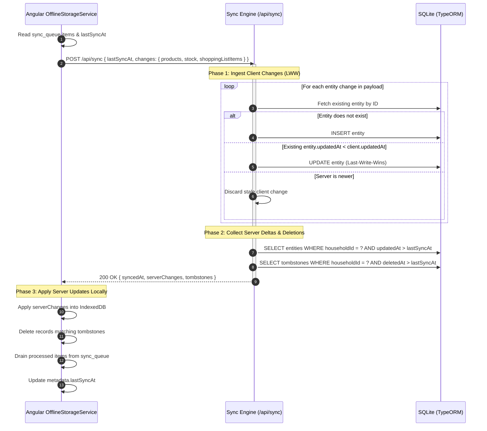

# Offline-First PWA & Synchronization Engine — Cambusa

Cambusa is engineered from the ground up as an offline-first Progressive Web Application. Users can review recipes, view inventory, strike through shopping items in grocery aisles with zero network connectivity, and synchronize seamlessly once reconnected.

---

## 1. PWA Infrastructure

### 1.1 Service Worker (`sw.js`)
The custom service worker implements a dual-caching strategy:
- **Cache-First (Static Assets)**: Scripts, stylesheets, fonts, webmanifest, and UI icons are served immediately from Cache Storage (`cambusa-static-v1`) to allow instant boot.
- **Network-First with Fallback (API & Dynamic Data)**: Network queries (`/api/*`) are attempted first. In offline conditions, requests are gracefully routed to local IndexedDB caches.
- **Product Images Cache (`cambusa-images-v1`)**: Product photos from `/uploads/products/*` are cached on first display and retained offline.

### 1.2 Web App Manifest (`manifest.webmanifest`)
Provides native-like mobile and desktop integration:
- `display: "standalone"`
- `start_url: "/"`
- `theme_color: "#2563eb"`
- `background_color: "#0f172a"`
- Standard and maskable icons (192x192, 512x512).

---

## 2. Client-Side Storage Architecture (IndexedDB)

The client initializes an IndexedDB database named `cambusa_offline_v1` with the following object stores:

| Object Store | Key Path | Indexes | Purpose |
| :--- | :--- | :--- | :--- |
| `products` | `id` | `householdId`, `barcodes`, `parentProductId` | Cached product catalog |
| `stock` | `id` | `householdId`, `productId`, `bestBeforeDate` | Cached pantry inventory items |
| `shopping_items` | `id` | `householdId`, `shoppingListId`, `storeId` | Cached shopping items |
| `stores` | `id` | `householdId` | Supermarkets & stores |
| `sync_queue` | `id` | `createdAt`, `entity` | FIFO queue of offline mutations |
| `metadata` | `key` | — | Sync state, e.g. `lastSyncAt` |

---

## 3. Navbar Sync Indicator & User Controls

Cambusa includes an animated sync status indicator in the top navigation bar:
- **Visual Status Pill**:
  - `online-ok`: Green glowing status pill indicating connected and up-to-date state.
  - `syncing`: Blue rotating animated indicator during active delta transfers.
  - `offline`: Amber warning pill when offline.
  - `error`: Red error pill when sync encounters transport failures.
- **Interactive Dropdown Panel**:
  - Displays online status, last error details, count of unpushed local modifications (`pendingCount`), and humanized relative sync timestamp (`formattedLastSync`, e.g. "Pochi secondi fa", "5m fa").
  - **Sincronizza ora (Force Sync)**: Immediately flushes local queue and fetches server deltas.
  - **Scarica versione server (Download Server Version)**: A recovery mechanism guarded by a CDK Dialog confirmation modal. It purges any pending unpushed local mutations, clears local IndexedDB entity stores, and downloads fresh authoritative state from the server.

---

## 4. Synchronization Protocol

Bi-directional synchronization is executed via the `POST /api/sync` endpoint.



---

## 5. Deletion Reconciliation via Sync Tombstones

Because offline clients cannot detect that an item was deleted on the server purely from delta queries, Cambusa records deletions in the `sync_tombstones` table:

```sql
CREATE TABLE sync_tombstones (
  id VARCHAR PRIMARY KEY,
  householdId VARCHAR NOT NULL,
  entityType VARCHAR NOT NULL, -- 'product' | 'stock' | 'shopping_item' | 'shopping_list' | 'store'
  entityId VARCHAR NOT NULL,
  deletedAt DATETIME NOT NULL
);
CREATE INDEX idx_tombstones_household_deleted ON sync_tombstones (householdId, deletedAt);
```

When an entity is deleted on the server or synced from a client:
1. The target entity is removed from its table.
2. A corresponding record is written to `sync_tombstones`.
3. During sync, any client whose `lastSyncAt < deletedAt` receives the tombstone entry and removes the item from its local IndexedDB store.

---

## 6. Conflict Resolution Strategy

Cambusa uses **Last-Write-Wins (LWW)** with UTC microsecond timestamps (`updatedAt`).
- Field-level collisions are resolved by comparing `client.updatedAt` against `server.updatedAt`.
- If client mutation timestamp > server timestamp, the client value replaces the server value.
- If server timestamp >= client mutation timestamp, the server state takes precedence and is returned in `serverChanges` to overwrite the client's local cache.
