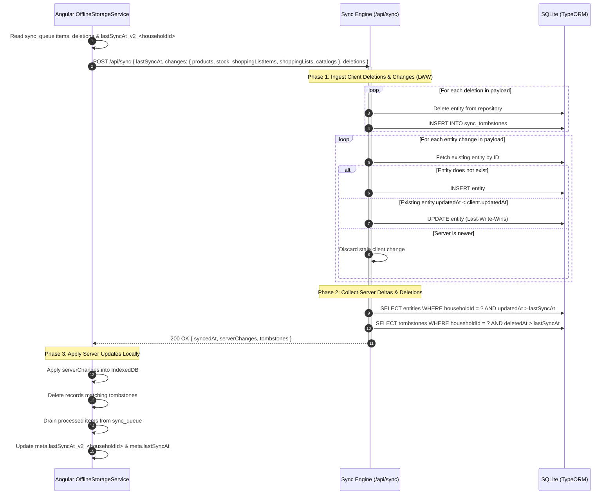

# Offline-First PWA & Synchronization Engine — Cambusa

Cambusa is engineered from the ground up as an offline-first Progressive Web Application. Users can review recipes, view inventory, strike through shopping items in grocery aisles with zero network connectivity, and synchronize seamlessly once reconnected.

---

## 1. PWA Infrastructure

### 1.1 Service Worker (`sw.js`)
The custom service worker implements a reliable offline-first caching and navigation strategy:
- **Precache on Install**: Core application shell assets (`/`, `/index.html`, `/manifest.webmanifest`, icons, and `/logo.webp`) are precached on service worker installation into `cambusa-cache-v${VERSION}`.
- **SPA Navigation Fallback**: Navigation requests (`mode: 'navigate'`) attempt network first and gracefully fall back to the precached `/index.html` when offline or disconnected.
- **Stale-While-Revalidate (Static Assets)**: Bundled scripts (`main-*.js`, `chunk-*.js`), stylesheets (`styles-*.css`), web fonts, and public assets are served immediately from cache while being revalidated and cached in the background when online.
- **Network-Only Bypasses**: API endpoints (`/api/*`), authentication and OAuth routes (`/auth/*`, `/oauth2/*`), health probes (`/health`), and dev server WebSocket connections bypass the service worker to prevent stale data conflicts and ensure IndexedDB and `SyncService` remain the authoritative source for domain records.

### 1.2 PWA Lifecycle & Update Engine (`PwaUpdateService`)
Cambusa includes an automated lifecycle service (`PwaUpdateService`) controlling service worker registration and updates:
- **Lifecycle Checks**: Automatically checks for updates upon application launch, periodically every 20 minutes, on visibility return (`document.visibilityState === 'visible'`), and upon reconnecting online (`window.ononline`).
- **Interactive Update Modal (`UpdateModalComponent`)**: When an updated service worker is installed and waiting, an alert dialog appears inviting the user to reload the application ("Refresh Now") or postpone ("Later").
- **Persistent Header Indicator**: If postponed, an animated "Update Available" pill button remains visible in the navigation topbar, allowing users to re-open the dialog at any time.
- **Seamless Controller Swap**: Confirming the update sends a `SKIP_WAITING` message to the waiting worker, activates the new version, and safely refreshes the window upon `controllerchange`.
- **Development Environment Cleanup**: In development mode (`isDevMode()`), active service workers and caches are automatically unregistered and purged to prevent interference with hot module reloading (HMR).

### 1.3 Web App Manifest (`manifest.webmanifest`)
Provides native-like mobile and desktop integration:
- `display: "standalone"`
- `start_url: "/"`
- `theme_color: "#2563eb"`
- `background_color: "#0f172a"`
- Standard and maskable icons (192x192, 512x512).

---

## 2. Client-Side Storage Architecture (IndexedDB)

The client initializes an IndexedDB database named `cambusa_offline_v1` with the following object stores:

| Object Store | Key Path | Indexes | Purpose |
| :--- | :--- | :--- | :--- |
| `products` | `id` | `householdId`, `barcodes`, `parentProductId` | Cached product catalog |
| `product_ratings` | `id` | `householdId`, `productId`, `userId` | Cached per-user product star ratings |
| `stock` | `id` | `householdId`, `productId`, `bestBeforeDate` | Cached pantry inventory items |
| `shopping_items` | `id` | `householdId`, `shoppingListId`, `storeId` | Cached shopping items |
| `shopping_lists` | `id` | `householdId` | Cached shopping lists |
| `meal_plan_entries` | `id` | `householdId`, `date`, `mealSlot`, `productId` | Cached weekly meal planner entries |
| `sync_queue` | `id` | `createdAt`, `entity` | FIFO queue of offline mutations |
| `meta` | `key` | — | Per-household sync cursors (`lastSyncAt_v2_<householdId>`), UI `lastSyncAt`, and cached catalogs (alphabetically sorted by `name` for units, product groups, locations, and stores; numerically sorted by `sortOrder` for `customFields`), aisles (numerically sorted by user-defined `sortOrder`), and dashboard snapshots |

### 2.1 Local-First Mutation Pipeline (Zero Direct API Mutations)
Cambusa enforces a strict offline-first architectural invariant: **the web client never makes direct REST API mutation calls for domain entities**.
1. **Local Write First**: When a user creates, updates, or deletes any domain entity (`StockItem`, `ShoppingListItem`, `ShoppingList`, `Product`, `ProductRating`, etc.), `ApiService` routes the operation directly into `OfflineStorageService` and local IndexedDB stores.
2. **Deterministic Enqueue**: A corresponding mutation payload is stored in the `sync_queue` object store with entity type, operation (`insert`, `update`, `delete`), and payload.
3. **Background Sync Trigger**: Once the local database transaction completes and in-memory signal state updates, `SyncService.sync()` is triggered asynchronously in the background to push mutations via `POST /api/sync`.
4. **Resilience to Network Drops**: If the client is offline or the server is temporarily unreachable, local operations succeed instantly without interruption, and queued changes persist safely across browser restarts until connectivity is restored.

---

## 3. Navbar Sync Indicator & User Controls

Cambusa includes an animated sync status indicator in the top navigation bar:
- **Visual Status Pill**:
  - `online-ok`: Green glowing status pill indicating connected and up-to-date state.
  - `syncing`: Blue rotating animated indicator during active delta transfers.
  - `offline`: Amber warning pill when offline.
  - `error`: Red error pill when sync encounters transport failures.
- **Interactive Dropdown Panel**:
  - Displays online status, last error details, count of unpushed local modifications (`pendingCount`), and humanized relative sync timestamp (`formattedLastSync`, e.g. "Pochi secondi fa", "5m fa").
  - **Sincronizza ora (Force Sync)**: Immediately flushes local queue and fetches server deltas.
  - **Scarica versione server (Download Server Version)**: A recovery mechanism guarded by a CDK Dialog confirmation modal. It purges any pending unpushed local mutations, clears local IndexedDB entity stores, and downloads fresh authoritative state from the server.

---

## 4. Synchronization Protocol

Bi-directional synchronization is executed via the `POST /api/sync` endpoint.



---

## 5. Deletion Reconciliation via Sync Tombstones

Because offline clients cannot detect that an item was deleted on the server purely from delta queries, Cambusa records deletions in the `sync_tombstones` table:

```sql
CREATE TABLE sync_tombstones (
  id VARCHAR PRIMARY KEY,
  householdId VARCHAR NOT NULL,
  entityType VARCHAR NOT NULL, -- 'product' | 'stock' | 'shopping_item' | 'shopping_list' | 'store'
  entityId VARCHAR NOT NULL,
  deletedAt DATETIME NOT NULL
);
CREATE INDEX idx_tombstones_household_deleted ON sync_tombstones (householdId, deletedAt);
```

When an entity is deleted on the server or synced from a client:
1. The target entity is removed from its table.
2. A corresponding record is written to `sync_tombstones`.
3. During sync, any client whose `lastSyncAt < deletedAt` receives the tombstone entry and removes the item from its local IndexedDB store.

---

## 6. Conflict Resolution Strategy

Cambusa uses **Last-Write-Wins (LWW)** with UTC microsecond timestamps (`updatedAt`).
- Field-level collisions are resolved by comparing `client.updatedAt` against `server.updatedAt`.
- If client mutation timestamp > server timestamp, the client value replaces the server value.
- If server timestamp >= client mutation timestamp, the server state takes precedence and is returned in `serverChanges` to overwrite the client's local cache.

---

## 7. Dashboard Optimistic State Management & Snapshot Undo

The Home Dashboard (`HomeComponent`) features zero-latency optimistic updates:
- **Instant In-Place Mutation (`applyOptimisticAction`)**: When stock actions (`consume`, `open`, `adjustDate`, `move`, `purchase`) are triggered from pantry action modals or the quick actions footer, the dashboard signal state (`nextData`) updates in-place immediately without triggering a full page reload or API query. Metrics (`totalStockItems`, `totalUniqueProductsInStock`, `expiredCount`, `expiringSoonCount`) and attention feeds (`expired`, `expiringSoon`) recalculate instantly.
- **Snapshot Undo Stack (`undoSnapshotStack`)**: Before mutating local signal state, a deep copy snapshot of the current `NextResponseDto` is pushed onto an in-memory undo stack. When `UndoService.onUndoExecuted` fires, the previous dashboard snapshot is popped and restored instantly without making network requests or displaying loading indicators.
- **Deterministic Local Recomputation (`computeNextDataLocally`)**: If an undo requires dynamic re-evaluation or an item outside the snapshot stack is mutated, the client derives the exact Next engine metrics and feeds locally from IndexedDB stores (`stock`, `products`, `units`, `locations`) without calling `/api/next`.
